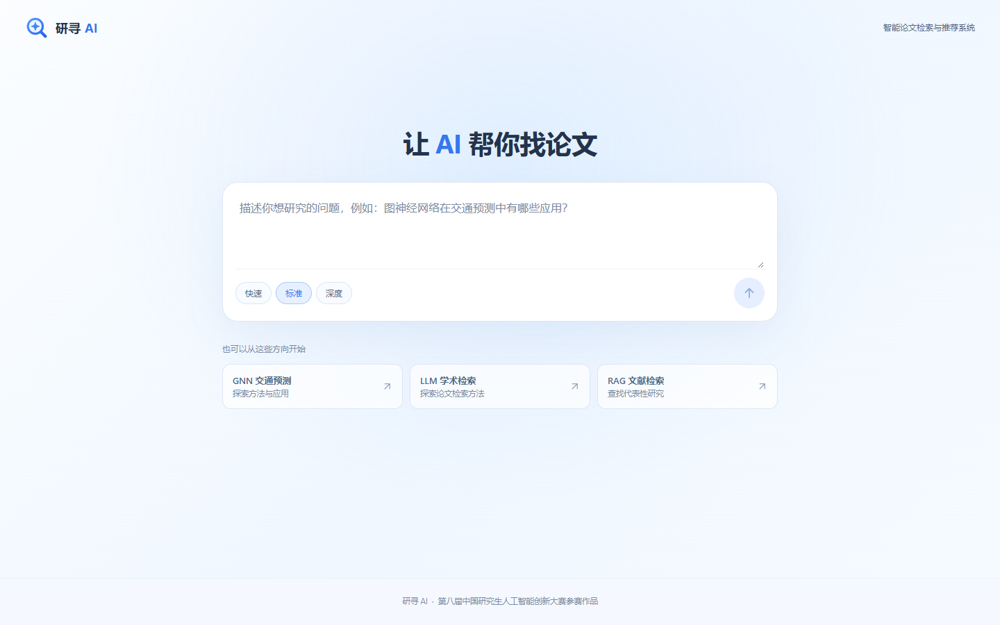
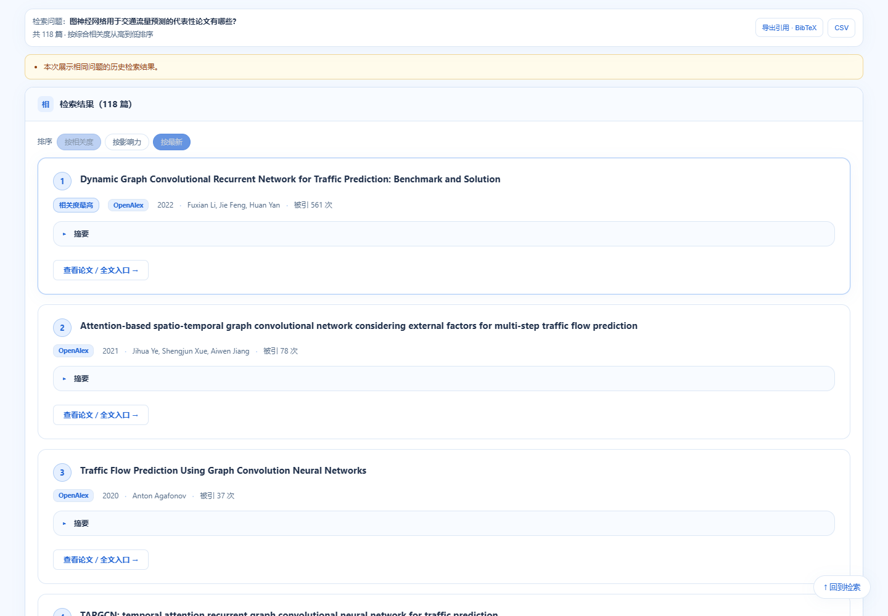
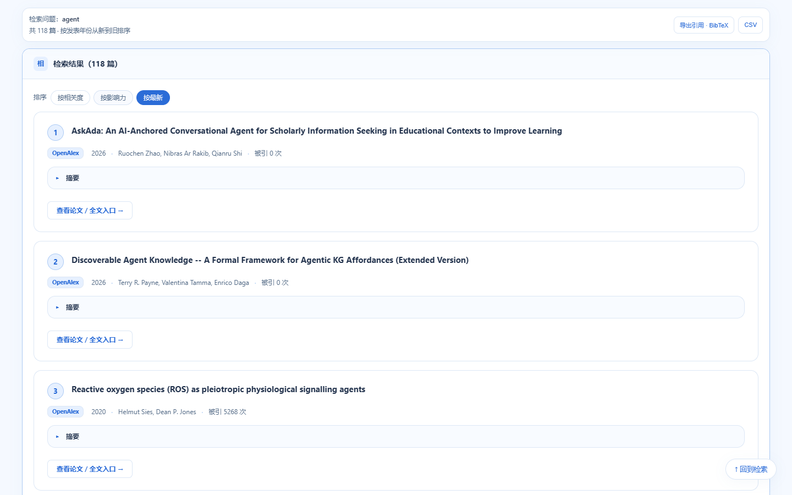

# 研寻 AI · Scholar Search Agent

面向复杂科研问题的学术论文检索与推荐系统。

用户用自然语言描述研究问题，系统让大模型自主决定「查什么、怎么查、什么时候停」，后端执行真实的学术检索并把结果回灌给模型，模型据此继续决策或结束，最终把真实论文候选排序后呈现给用户。

> 第八届中国研究生人工智能创新大赛参赛作品。





---

## 这个系统解决什么问题

普通的学术搜索要求你把问题拆成关键词。但真实的研究问题往往带着约束——方法、任务、领域、年份——而且「哪篇论文算代表性」本身需要判断。

本系统把这件事交给一个工具调用循环：

1. **模型先理解问题**，明确用户提出的方法、任务、领域、时间范围。这些要求贯穿全过程，不会被擅自替换。
2. **模型自主选择检索动作**——关键词搜索、语义搜索、引文扩展，或直接结束。没有预设的固定流程和固定轮数。
3. **后端真实执行**检索，把真实返回的论文（带稳定编号、标题、年份、摘要片段）作为工具结果回传。
4. **模型根据新证据再次决策**：补查缺口、换来源、还是收尾。
5. **系统融合去重、评分排序**，页面提供摘要、原文入口、翻页、重新排序与导出。

模型永远拿不到「编造论文」的机会：展示层只接受工具真实返回的论文记录，模型输出的文本不会被当成论文。引文扩展也只能围绕后端已收集的论文编号展开。

---

## 主要特性

### 检索
- **自主工具调用**：模型按需在 `search_papers` / `semantic_search` / `expand_citations` / `finish_search` 之间选择，顺序和轮数不固定。
- **多源召回**：OpenAlex 词项检索与语义检索、arXiv 预印本、Crossref、Semantic Scholar，含来源故障自动切换。
- **双层时间约束**：年份等条件由程序统一施加，不由模型自行放宽。
- **安全边界**：工具名与参数走 Pydantic 白名单校验（`extra="forbid"`, `strict=True`），模型无法执行任意函数；单次检索上限 30 条；带预算、超时、无增益停止等多重兜底。
- **结果不丢**：触达预算、工具失败、结束说明格式异常时，已获得的真实候选都会保留并给出对应提示，不会静默清空。

### 排序与展示
- **TRACE-Rank**：多路径 RRF 融合、词项与语义相关性、查询约束覆盖、引用影响力、新近性、多样性重排。
- **三种前端排序**：按相关度（默认）/ 按影响力（被引降序）/ 按最新（发表年份降序），切换只重排同一批候选，不重新检索。
- **分页浏览**：每页 10 篇，支持全量翻页。
- **导出**：BibTeX、CSV、完整 JSON。



### 兼容的经典工作流
除 Agent 路径外，项目保留了完整的两轮迭代检索工作流（`search_strategy=workflow`），包含一组已在冻结划分上调过的关系证据方法：

| 模块 | 作用 |
|---|---|
| SCGQ / QCF | 从高置信种子批量探索正反向引文前沿，保留引文方向与种子桥接证据 |
| REG-MEQ | 条件合取、最弱条件、关系谓词、引文方向、种子桥接五路证据仲裁，受控晋升 Top20 尾部 |
| EBP | 将候选多视图证据沿未解析引文边反投影，批量恢复高支持论文 |
| ECS | 40 维查询内证据向量，形成核心结果置信度 |
| HELIOS-Lite | 基于约束缺口、重复率、漂移与调用成本决定扩展或停止，返回决策轨迹 |

> Agent 路径复用 TRACE-Rank 对真实候选评分，但**不套用**上述 REG/EBP/ECS 的实验数字——那些结论属于 workflow 路径，口径不同，不能混为一谈。

---

## 快速开始

### 环境要求
- Python **3.12+**（开发与验证环境为 3.13）
- Windows（一键脚本）；其他平台可用手动命令

### 一键启动（Windows）

```text
1. 运行 安装开发环境.bat  （首次，创建 .venv 并安装依赖）
2. 把 .env.example 复制为 .env，填入 DEEPSEEK_API_KEY
3. 双击 一键启动_研问智搜.bat
4. 浏览器打开 http://127.0.0.1:8002
```

### 手动启动

```bash
python -m venv .venv
# Windows: .venv\Scripts\python.exe   Linux/macOS: .venv/bin/python
.venv/Scripts/python.exe -m pip install -r requirements.txt
cp .env.example .env      # 填入密钥
.venv/Scripts/python.exe -m uvicorn backend.main:app --host 127.0.0.1 --port 8002
```

健康检查：`GET http://127.0.0.1:8002/api/health` → `{"status":"ok"}`

### 配置项

`.env`（**不要提交到仓库**）：

| 变量 | 必需 | 说明 |
|---|---|---|
| `DEEPSEEK_API_KEY` | Agent 路径必需 | 大模型密钥；缺失时 Agent 路径会明确报错而不是静默降级 |
| `DEEPSEEK_AGENT_MODEL` | 否 | Agent 使用的模型，默认 `deepseek-flash`，须支持原生工具调用 |
| `OPENALEX_API_KEY` / `OPENALEX_API_KEYS` | 否 | 提高 OpenAlex 额度 |
| `S2_API_KEY` | 否 | Semantic Scholar 额度 |

---

## 使用方式

打开首页，输入研究问题，选择检索深度后发送。

**三种深度**只改变可用预算，不指定必须执行的动作：

| 深度 | 最多模型决策 | 最多工具尝试 | 时间上限 |
|---|---:|---:|---:|
| 快速 | 4 | 5 | 60 秒 |
| 标准 | 8 | 10 | 120 秒 |
| 深度 | 12 | 16 | 180 秒 |

页面会提示本次是检索结果还是命中历史缓存、是否触及预算上限、覆盖情况是否仍需人工核对。

> 说明：系统依据标题、摘要片段与学术元数据工作，**不宣称已阅读全文或找全全部相关论文**；候选池中可能仍含低相关论文，展示的是候选而非逐篇确认的精选结果。

---

## API

### 网页接口（白名单响应）

```http
POST /api/search
Content-Type: application/json
```

```json
{
  "query": "图神经网络用于交通流量预测的代表性论文有哪些？",
  "search_strategy": "agent",
  "mode": "balanced"
}
```

响应只包含面向用户的最小字段，不泄露内部评分、证据图与检索过程：

```json
{
  "query": "...",
  "papers": [
    {
      "rank": 1,
      "title": "...",
      "authors": ["..."],
      "year": 2025,
      "abstract": "...",
      "cited_by_count": 42,
      "doi": "...",
      "url": "...",
      "source_api": "OpenAlex"
    }
  ],
  "notices": []
}
```

### 请求参数

| 参数 | 取值 | 默认 | 说明 |
|---|---|---|---|
| `query` | string | — | 研究问题 |
| `search_strategy` | `agent` / `workflow` | `workflow` | 网页显式使用 `agent`；省略时保留 `workflow` 以兼容历史评测口径 |
| `mode` | `quick` / `balanced` / `deep` / `efficient` / `helios` | `balanced` | Agent 路径下即为预算档位 |
| `selection_profile` | `f1` / `balanced_set` / `exploratory` | `f1` | 结果集合策略（workflow 路径语义更明显） |
| `retrieval_profile` | `relational` / `lean` / `v3` / ... | `relational` | 仅作用于 workflow 路径；Agent 由模型自主选工具 |

> 两条路径使用**互相隔离的缓存命名空间**，切换策略不会命中另一条路径的旧结果。

完整内部结果（含评分、证据、检索轨迹）保留在服务端，供评测与调试使用，不通过 HTTP 暴露。

---

## 项目结构

```text
backend/
  main.py                  FastAPI 入口、请求分发、Agent/工作流两条路径
  agent_retrieval.py       Function Calling 检索循环（观察→决策→执行→反馈）
  agent_tools.py           工具白名单、参数校验、工具适配
  llm_client.py            DeepSeek 客户端（工具调用轮次 + 查询理解/扩展）
  public_response.py       网页响应白名单（内部字段不出后端）
  trace_rank.py            TRACE-Rank 融合评分与多样性重排
  query_understanding.py   查询理解与意图识别
  openalex_client.py       OpenAlex 词项/语义/引文接口
  arxiv_client.py          arXiv 检索
  crossref_client.py       Crossref 检索
  semantic_scholar_client.py
  paper_identity.py        DOI / arXiv / OpenAlex / S2 稳定身份对齐
  helios_lite.py           自适应扩展/停止控制器
  response_cache.py        完整响应磁盘缓存
  retrieval/               引文前沿检索模块（SCGQ / QCF / EBP 等）
  selection/               证据排序与集合选择模块（REG-MEQ / ECS 等）

frontend/
  index.html               单文件前端（界面 + 交互，无构建步骤）
  themes.css               配色主题
  theme-preview.html       主题预览

scripts/                   benchmark、诊断、报告生成
configs/                   查询集与实验配置
reports/                   实验报告与审计结果
docs/                      设计说明、论文稿件、运行速查
tests/                     单元测试（216 项）
demo/frozen_response.json  离线演示用的真实冻结响应
```

---

## 测试

```bash
.venv/Scripts/python.exe -m pytest -q
```

当前：**216 passed**（其中 Agent 协议与循环相关测试 34 项）。

```text
注意：单元测试验证的是控制流程与数据结构，不代表检索相关性或召回率的系统性评测。
```

---

## 离线演示

双击 `离线演示_研问智搜.bat`。该模式（`SCHOLAR_FROZEN_DEMO=1`）回放随包保存的真实冻结响应，不访问外部 API，适合断网现场保底；页面会明确标注为离线结果，不会伪装成实时检索。

离线演示与正常服务共用 8002 端口，切换前先停止正在运行的服务。

---

## 已知边界

诚实说明，避免过度宣称：

- **依赖大模型**：Agent 路径需要可用的模型密钥；未配置时返回明确错误，不静默回退到旧流程。
- **不读全文**：模型看到的是标题、年份与摘要片段，未实现全文下载与全文证据核验。
- **预算为工程初值**：上表中的次数与时长是第一版上限，尚未依据效果/耗时实验调优。
- **结束 ≠ 找全**：模型主动结束、预算耗尽、工具失败都只代表本次检索到此为止。
- **效果评测口径分离**：仓库中的 REG/EBP/ECS 数字属于 workflow 路径的冻结划分实验；Agent 路径尚未做等预算质量对比。
- **缓存优先**：相同问题与深度可能命中历史结果，页面会如实标注。

---

## 致谢与第三方

第三方依赖与许可说明见 [`THIRD_PARTY_NOTICES.md`](THIRD_PARTY_NOTICES.md)。

学术数据来自 OpenAlex、arXiv、Crossref、Semantic Scholar 各自的公开接口，使用时请遵守各数据源的服务条款。
